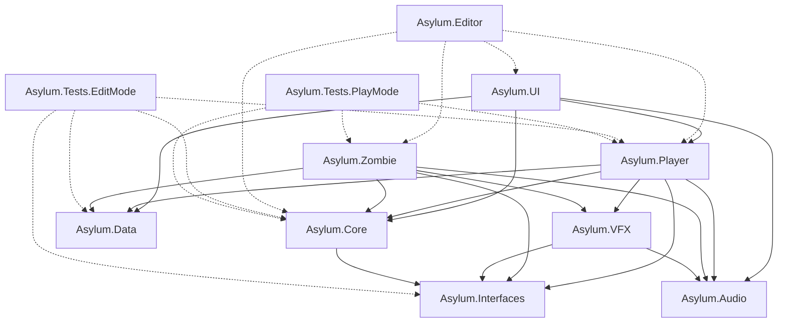

# Abandoned Asylum 3D — Survival Horror TPS

Một dự án trò chơi góc nhìn thứ ba (Third-Person Shooter) kết hợp yếu tố kinh dị sinh tồn, phát triển trên nền tảng Unity 2022.3 LTS. Dự án tập trung vào kiến trúc phân tách mô-đun hóa qua Assembly Definitions, quản lý bộ nhớ trên các vòng lặp xử lý chính (Hot Paths), điều phối hoạt ảnh thủ tục (Procedural Spine Alignment & Two-Bone Hand IK) và máy trạng thái AI NavMesh.

---

## 🎮 Tổng Quan Trò Chơi

Người chơi điều khiển nhân vật thám hiểm trong khuôn viên bệnh viện tâm thần Karlheinz bị phong tỏa. Nhiệm vụ chính là định vị và tiêu diệt các cổng dị thường không gian (Dimensional Portals) để ngăn chặn nguồn lây nhiễm, đồng thời tự vệ trước các đợt tấn công của quái vật đột biến.

* **Thể loại:** 3D Survival Horror / Third-Person Shooter (TPS)
* **Engine:** Unity 2022.3 LTS
* **Render Pipeline:** Built-in Render Pipeline (PBR Shading)
* **Nền tảng mục tiêu:** PC (Windows Standalone 64-bit)
* **Hệ thống điều khiển:** Unity New Input System (hỗ trợ Gamepad và lớp tương thích Legacy Input)

---

## 🚀 Các Đặc Tính Kỹ Thuật Chính

### 1. Căn Chỉnh Nòng Súng Thủ Tục & Animation Rigging (Two-Bone Hand IK)
* **Procedural Spine Alignment:** [`PlayerAimRigController`](Assets/Scripts/Player/PlayerAimRigController.cs) tính toán góc lệch Pitch và Yaw giữa nòng súng và điểm chiếu Raycast từ Camera, bù trừ góc xoay theo tỷ lệ `Spine1` (35%) và `Spine2` (65%).
* **Animation Rigging:** Tích hợp `UnityEngine.Animations.Rigging` với `TwoBoneIKConstraint` cho tay trái, giữ tay cầm nẹp chắc chắn vào ốp lót tay của súng trong suốt các trạng thái di chuyển, chạy nước rút và ngắm bắn.

### 2. Hệ Thống Camera TPS Cinemachine
* **State Blending:** Điều phối bởi [`PlayerCameraController`](Assets/Scripts/Player/PlayerCameraController.cs) qua hai Virtual Camera rigs:
  * **Exploration Rig (FOV 60°):** Góc nhìn mở rộng ngang vai khi di chuyển thám hiểm.
  * **Combat Aim Rig (FOV 42°):** Thu hẹp góc nhìn và tăng độ ưu tiên khi giữ chuột phải ngắm bắn.
* **CinemachineCollider:** Sử dụng chiến lược `PullCameraForward` kết hợp lọc tầng va chạm (Layer Filtering) để tránh tình trạng camera xuyên tường trong các hành lang hẹp.

### 3. Máy Trạng Thái AI Quái Vật & Chống Kẹt NavMesh
* **3-Tier Fallback Pathfinding:** [`ZombieController`](Assets/Scripts/Zombie/ZombieController.cs) bảo đảm khả năng tìm đường liên tục trên địa hình NavMesh:
  1. Dẫn đường trực tiếp đến tọa độ mục tiêu người chơi.
  2. Lấy mẫu điểm NavMesh gần nhất trong bán kính 12m khi đường đi bị gián đoạn.
  3. Lấy mẫu hướng nhìn (Probe Sampling) phía trước 6m để vượt qua ngưỡng cửa hoặc mối nối phẳng.
* **Cơ chế chống kẹt (Anti-Stuck):** Tự động phát hiện khi quái vật bị đứng yên ($< 0.12\text{m}$ trong $0.5\text{s}$) để áp dụng lực đẩy vật lý và xoay hướng nhìn slerp về phía người chơi.
* **Tấn công cận chiến có kiểm soát:** Cố định vị trí chân khi vung đòn (cự ly $1.85\text{m}$) tránh trượt băng chân, kết hợp cửa sổ quét va chạm Hitbox theo normalized time hoạt ảnh.

### 4. Quản Lý Bộ Nhớ & Tối Ưu Hóa Vòng Lặp Chính
* **Non-Alloc Physics Raycasting:** Các phép quét va chạm đạn và cào cận chiến sử dụng `Physics.RaycastNonAlloc` và `Physics.OverlapSphereNonAlloc` với mảng đệm cố định (`RaycastHit[8]`, `Collider[16]`), làm sạch tham chiếu sau khi duyệt để ngăn ngừa rò rỉ bộ nhớ.
* **Zero Coroutines trong Hot Path:** Hiệu ứng bắn súng, tia lửa đầu nòng và trạng thái tử trận của quái vật được điều khiển qua bộ đếm delta time (`Time.deltaTime` / `Time.unscaledDeltaTime`), loại bỏ cấp phát `IEnumerator` trên Heap.
* **Object Pooling:** Tái sử dụng đạn vạch đường ([`TracerBullet`](Assets/Scripts/VFX/TracerBullet.cs)) bằng Circular Pool, tái sử dụng quái vật qua [`ComponentPool<ZombieController>`](Assets/Scripts/Core/ComponentPool.cs) với cấu trúc LIFO Stack $O(1)$.
* **Bộ đệm âm thanh đa kênh:** [`GameAudioFX`](Assets/Scripts/Audio/GameAudioFX.cs) sử dụng hồ chứa 16 kênh `AudioSource` xoay vòng, giảm thiểu chi phí khởi tạo AudioSource khi phát âm thanh va chạm và tiếng súng.
* **Streaming Mipmaps:** Kích hoạt tính năng Streaming Mipmaps trong QualitySettings với ngân sách VRAM 512 MB.
* **Fast Enter Play Mode:** Khởi tạo và thiết lập lại biến tĩnh qua `[RuntimeInitializeOnLoadMethod(RuntimeInitializeLoadType.SubsystemRegistration)]` để hỗ trợ tắt Domain Reload trong Unity Editor.

---

## 🏗️ Kiến Trúc Hệ Thống & Mẫu Thiết Kế (Design Patterns)



| Mẫu thiết kế / Nguyên lý | Thành phần triển khai | Mục đích kỹ thuật |
|---|---|---|
| **Modular Assembly Definitions (.asmdef)** | `Asylum.*.asmdef` (11 isolated assemblies) | Phân tách ranh giới biên dịch, loại bỏ phụ thuộc vòng tròn, tối ưu hóa thời gian recompile và hỗ trợ song song hóa quá trình build. |
| **Service Locator / Dependency Inversion** | `ServiceLocator.cs`, `IGameStateService`, `IAudioService` | Tách rời các phụ thuộc trực tiếp giữa UI, Player, Zombie và hệ thống quản lý vòng đời trò chơi. |
| **State Pattern (Finite State Machine)** | `IZombieState`, `ZombieChaseState`, `ZombieAttackState`, `ZombieDeathState` | Đóng gói hành vi quái vật thành các lớp trạng thái độc lập, quản lý chuyển trạng thái và thời gian xác chết bằng delta timer. |
| **Strategy Pattern** | `IWeaponStrategy`, `RifleWeaponStrategy`, `ShotgunWeaponStrategy` | Tách biệt giải thuật tính toán đạn đạo, số lượng pellet, độ giật và quét va chạm ra khỏi `PlayerWeaponController` qua cấu trúc `in WeaponFireContext`. |
| **Open/Closed Principle (OCP)** | `WeaponDataSO.cs`, `ZombieDataSO.cs` | Dữ liệu cấu hình vũ khí và quái vật được trừu tượng hóa dưới dạng ScriptableObject, hỗ trợ thêm mới loại vũ khí hoặc quái vật mà không sửa code lõi. |
| **Interface Segregation (ISP)** | `IDamageable`, `IInputService`, `IPlayerStatsNotifier` | Phân lập rõ ràng giữa đối tượng nhận sát thương, dịch vụ cung cấp tín hiệu điều khiển và kênh thông báo chỉ số cho UI. |
| **Model-View-Presenter (MVP)** | `UIManager.cs` + Bloodlines Views (`HUDView`, `MainMenuView`) | Presenter đóng vai trò trung gian đăng ký sự kiện từ `IPlayerStatsNotifier` và cập nhật dữ liệu lên View mà không gắn chặt View vào logic game. |
| **Generic Object Pool Pattern** | `IObjectPool<T>`, `ComponentPool<T>`, `ZombiePool.cs` | Công cụ cấp phát và thu hồi đối tượng theo cấu trúc LIFO Stack, triệt tiêu `Instantiate` và `Destroy` trong vòng lặp chiến đấu. |
| **Layered Physics Configuration** | `PhysicsLayerConfigurator.cs` (`[RuntimeInitializeOnLoadMethod]`) | Tắt các cặp va chạm vật lý không cần thiết (Projectile vs Projectile, Projectile vs Player, UI/IgnoreRaycast) khi khởi động. |

---

## 📦 Cấu Trúc Thư Mục & Assembly Definitions

```text
AbandonedAsylum_3D/
├── Assets/
│   ├── Abandoned_Asylum/   # Môi trường bệnh viện, modular rooms, vật liệu PBR và Lightmaps
│   ├── Alebardium/         # Bloodlines UI theme textures và audio giao diện
│   ├── Characters/         # Mô hình 3D người chơi, quái vật Zombie và Animator Controllers
│   ├── Data/               # ScriptableObject instances (AssaultRifle, Zombie_Parasite)
│   ├── Editor/             # Asylum.Editor.asmdef (Các công cụ tự động hóa kiểm tra Scene)
│   ├── Prefabs/            # Các Prefabs hoàn chỉnh (Portals, Zombie Parasite)
│   ├── Resources/          # Dynamic UI prefabs và audio clips
│   ├── Scenes/             # Scene chính (Karlheinz_Asylum_Main.unity)
│   ├── Scripts/            # Mã nguồn phân tách theo Assembly Definitions (.asmdef)
│   │   ├── Audio/          # Asylum.Audio.asmdef (GameAudioFX pool âm thanh)
│   │   ├── Core/           # Asylum.Core.asmdef (GameManager, ServiceLocator, ComponentPool)
│   │   ├── Data/           # Asylum.Data.asmdef (WeaponDataSO, ZombieDataSO)
│   │   ├── Interfaces/     # Asylum.Interfaces.asmdef (Hợp đồng IDamageable, IAudioService, ...)
│   │   ├── Player/         # Asylum.Player.asmdef (Locomotion, AimRig, WeaponController)
│   │   │   └── Weapons/    # Chiến lược vũ khí (IWeaponStrategy, Rifle, Shotgun)
│   │   ├── UI/             # Asylum.UI.asmdef (MVP Presenter & View components)
│   │   ├── VFX/            # Asylum.VFX.asmdef (TracerBullet pool & gore particles)
│   │   └── Zombie/         # Asylum.Zombie.asmdef (ZombieController, ZombiePool, FSM States)
│   └── Tests/
│       ├── EditMode/       # Asylum.Tests.EditMode.asmdef (Unit tests cho DI, Health, Weapons)
│       └── PlayMode/       # Asylum.Tests.PlayMode.asmdef (Integration tests cho pools & hot loop)
├── ProjectSettings/        # Cấu hình Input, Physics (TagManager & DynamicsManager), Quality
├── Packages/               # Package manifest (Cinemachine, Animation Rigging, TextMeshPro)
├── .gitattributes          # Cấu hình Git LFS cho binary assets
├── .gitignore              # Bộ lọc bỏ qua các tệp tạm thời của Unity
└── README.md               # Tài liệu kỹ thuật dự án
```

---

## 🕹️ Bảng Phím Điều Khiển (Controls)

| Thao tác | Phím / Tín hiệu đầu vào |
|---|---|
| **Di chuyển** | `W`, `A`, `S`, `D` / Các phím mũi tên |
| **Chạy nhanh (Sprint)** | `Left Shift` + Tiến về phía trước |
| **Ngắm bắn (ADS)** | Giữ `Chuột Phải` (Mouse Right Click) |
| **Bắn súng** | `Chuột Trái` (Mouse Left Click) |
| **Nạp đạn** | `R` (hoặc tự động khi hết băng đạn) |
| **Nhảy** | `Phím Cách` (Spacebar) |
| **Tạm dừng / Mở khóa chuột** | `Escape` |

---

## ⚙️ Quy Trình Biên Dịch & Kiểm Thử Tự Động

1. **Biên dịch qua .NET CLI:**
   ```bash
   dotnet build AbandonedAsylum_3D.sln -v:m
   # Kết quả mong đợi: Build succeeded. 0 Warning(s), 0 Error(s)
   ```
2. **Chạy bộ kiểm thử tự động (Unity Test Framework):**
   * Trong Unity Editor: Menu **Window** $\rightarrow$ **General** $\rightarrow$ **Test Runner**.
   * Chạy toàn bộ **EditMode** và **PlayMode** tests.
3. **Đóng gói bản cài đặt Standalone Windows 64-bit:**
   * Trong Unity Editor: Menu **Build** $\rightarrow$ **BUILD STANDALONE WIN64** (`Ctrl+Alt+B`).
